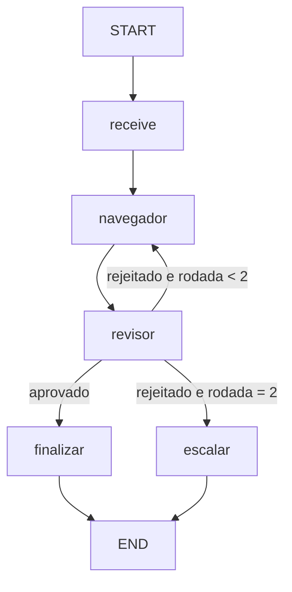
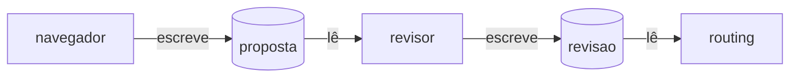

# Semana 2, exercício 1 (introdutório): navegador e revisor de segurança

**Quando:** meio da semana (segunda e terça). **Tema:** sistema multiagente, parte 1. **Dados:** [`dados/situacao_tempestade.json`](dados/situacao_tempestade.json). **Pré-requisito:** semana 1.

## O desafio, em poucas palavras

No desafio final, **nenhum comando vai direto para o navio**. Um agente **propõe** uma ação e **outro agente, diferente, revisa** essa proposta. Só depois de aprovada ela vira comando. Isso reduz erros e é uma exigência do desafio: cada grupo precisa de **no mínimo 2 agentes** distintos, que participam das mesmas decisões.

A situação típica é a **tempestade**: o navio precisa reduzir a velocidade para um valor seguro. Quem propõe pode errar; quem revisa conhece as regras e barra a proposta insegura.

Neste exercício você monta esse par de agentes com LangGraph, **sem ferramentas e sem MCP ainda**. O foco é a **colaboração entre dois agentes** e o **laço de correção** com limite de tentativas.

## O que você vai aprender

- O que é um **agente**: um papel (prompt) + saída estruturada + estado.
- Como dois agentes **compartilham estado** em um grafo.
- Como o revisor fica **independente** do proponente.
- Um **laço** com condicional: rejeitou, volta; passou do limite, escala.

## As regras do problema

| Regra | Valor |
|---|---|
| Velocidade-alvo | de 0 a 18 nós |
| Tempestade, rota **direta** | no máximo **12 nós** |
| Tempestade, rota **protegida** | no máximo **15 nós** |
| Sem tempestade | nenhuma mudança necessária |

Importante: **só o revisor conhece a tabela de limites**. O navegador recebe uma instrução simplificada: "em tempestade, reduza 1 nó da velocidade atual". Isso é proposital: o navegador vai errar às vezes, e o revisor existe para pegar o erro.

Os dados:

| Navio | Rota | Velocidade atual (nós) | Tempestade |
|---|---|---:|:---:|
| S1-FAROL | direta | 14 | sim |
| S2-MARE | protegida | 16 | sim |
| S3-CORAL | direta | 12 | não |

## O grafo que você vai construir



| Nó | Agente | Tipo | O que faz |
|---|---|---|---|
| `receive` | - | código | carrega o navio pelo `ship_id` |
| `navegador` | proponente | LLM (saída estruturada) | propõe `SET_SPEED` com uma velocidade, ou `NO_ACTION` |
| `revisor` | segurança | LLM (saída estruturada) | aprova ou rejeita, conhecendo a tabela de limites |
| `finalizar` | - | código | resume a ação aprovada |
| `escalar` | - | código | registra que não houve acordo (sem comando) |

## Passo a passo

1. **Projeto:** copie o projeto da semana 1. Mantenha `src/utils` e `src/app`. Reescreva `src/graph` (state, nós, prompts, routing, builder). Copie `dados/situacao_tempestade.json`.
2. **Estado** (`state.py`): `ship_id`, `navio`, `proposta`, `revisao`, `rodada`, `resultado`.
3. **Prompts** (em `prompts/`): um para o navegador e outro para o revisor. Cada um com seu papel e suas regras (veja a tabela acima).
4. **Modelos de saída** (Pydantic): `Proposta` (`acao`, `velocidade_kn`, `motivo`) e `Revisao` (`aprovado`, `motivo`).
5. **Nós:** `receive`, `navegador`, `revisor`, `finalizar`, `escalar`.
   - O navegador **incrementa** `rodada` e, se existir feedback de uma rejeição anterior, o recebe no prompt.
   - O revisor **não recebe o `motivo`** do navegador, só a ação e a velocidade. Assim ele julga a ação, não a justificativa.
6. **Roteamento** (`routing.py`): `route_after_review` devolve `aprovado`, `tentar_de_novo` ou `esgotado`. Limite: 2 rodadas.
7. **Builder** e **`main.py`**: rode os três navios, um de cada vez.

## Resultado esperado

| Navio | O que deve acontecer |
|---|---|
| S1-FAROL | rodada 1: o navegador propõe 13 nós; o revisor **rejeita** (limite 12 na rota direta). Rodada 2: propõe 12; **aprovado**. Resultado: `SET_SPEED 12` |
| S2-MARE | rodada 1: o navegador propõe 15 nós (16 − 1); o revisor **aprova** (limite 15 na rota protegida) |
| S3-CORAL | sem tempestade: `NO_ACTION`, aprovado na rodada 1 |

Exemplo de saída:

```text
S1-FAROL: SET_SPEED 12.0 nós (aprovado na rodada 2)
S2-MARE: SET_SPEED 15.0 nós (aprovado na rodada 1)
S3-CORAL: nenhuma ação necessária
```

LLMs variam. Se o navegador acertar de primeira no S1-FAROL, piore o prompt dele de propósito (por exemplo, "mantenha a velocidade atual") para ver a rejeição e o laço funcionando.

## Como verificar

- [ ] Há dois prompts distintos, um por agente, em `prompts/`.
- [ ] O revisor **não** vê o campo `motivo` da proposta.
- [ ] O S1-FAROL passa por pelo menos uma rejeição (ou você forçou a rejeição alterando o prompt).
- [ ] O laço termina: com 2 rodadas sem acordo o grafo vai a `escalar`.
- [ ] Nenhuma decisão é executada sem a aprovação do revisor.

## Para pensar

1. Por que o revisor não deveria ver o raciocínio do navegador?
2. O que acontece se os dois agentes usarem o **mesmo** prompt? Ainda é "revisão"?
3. Por que limitar as rodadas? O que seria um laço sem limite em produção (tempo, tokens)?
4. No desafio final, o comando precisa ter proposta e revisão **do mesmo `action_hash`** e **por agentes diferentes**. O que isso impede?

## Desafio extra (opcional)

- Faça o revisor devolver também o **limite correto** e use-o no feedback.
- Adicione o `rodada` e o motivo da rejeição ao texto final.
- Rode os três navios dentro de um único grafo, com um nó que percorre a lista.

---

# Como resolver (gabarito do instrutor)

## Ideia geral

Um **agente** aqui é um nó de LLM com **papel próprio** (prompt) e **saída estruturada**. Dois agentes colaboram porque **escrevem e leem o mesmo estado**:

- o navegador escreve `proposta`;
- o revisor lê `proposta` e escreve `revisao`;
- uma aresta condicional lê `revisao` e decide: concluir, voltar ao navegador ou escalar.



## `src/graph/state.py`

```python
from typing import TypedDict


class State(TypedDict, total=False):
    ship_id: str
    navio: dict
    proposta: dict
    revisao: dict
    rodada: int
    resultado: str
```

## Prompts

`src/graph/prompts/navegador_prompt.py`:

```python
from langchain_core.prompts import ChatPromptTemplate

NAVEGADOR_PROMPT = ChatPromptTemplate.from_messages(
    [
        (
            "system",
            "Você é o agente de navegação. Em tempestade, proponha SET_SPEED reduzindo "
            "1 nó da velocidade atual. Sem tempestade, proponha NO_ACTION. "
            "Velocidades válidas: de 0 a 18 nós, em passos de 0,5. "
            "Se houver feedback do revisor, corrija a proposta de acordo com ele.",
        ),
        ("human", "Navio: {navio}\nFeedback do revisor (pode estar vazio): {feedback}"),
    ]
)
```

`src/graph/prompts/revisor_prompt.py`:

```python
from langchain_core.prompts import ChatPromptTemplate

REVISOR_PROMPT = ChatPromptTemplate.from_messages(
    [
        (
            "system",
            "Você é o agente de segurança e revisa propostas de navegação. Regras:\n"
            "- Tempestade na rota direta: velocidade máxima de 12 nós.\n"
            "- Tempestade na rota protegida: velocidade máxima de 15 nós.\n"
            "- Sem tempestade: a ação correta é NO_ACTION.\n"
            "Aprove só se a proposta respeitar as regras. Se rejeitar, diga o limite correto "
            "no motivo.",
        ),
        ("human", "Navio: {navio}\nProposta a revisar: {proposta}"),
    ]
)
```

## Nós

`src/graph/nodes/receive.py`:

```python
import json
from pathlib import Path

from src.graph.state import State

ARQUIVO = Path(__file__).resolve().parents[3] / "dados" / "situacao_tempestade.json"


def receive(state: State) -> dict:
    navios = json.loads(ARQUIVO.read_text(encoding="utf-8"))["navios"]
    navio = next(n for n in navios if n["id"] == state["ship_id"])
    return {"navio": navio, "rodada": 0, "revisao": {}}
```

`src/graph/nodes/navegador.py`:

```python
import json
from typing import Literal

from pydantic import BaseModel

from src.graph.prompts.navegador_prompt import NAVEGADOR_PROMPT
from src.graph.state import State
from src.utils.llm_adapter import get_llm


class Proposta(BaseModel):
    acao: Literal["SET_SPEED", "NO_ACTION"]
    velocidade_kn: float | None = None
    motivo: str


def navegador(state: State) -> dict:
    revisao = state.get("revisao") or {}
    feedback = "" if revisao.get("aprovado", True) else revisao.get("motivo", "")
    chain = NAVEGADOR_PROMPT | get_llm().with_structured_output(Proposta)
    proposta = chain.invoke(
        {"navio": json.dumps(state["navio"], ensure_ascii=False), "feedback": feedback}
    )
    return {"proposta": proposta.model_dump(), "rodada": state.get("rodada", 0) + 1}
```

`src/graph/nodes/revisor.py`:

```python
import json

from pydantic import BaseModel

from src.graph.prompts.revisor_prompt import REVISOR_PROMPT
from src.graph.state import State
from src.utils.llm_adapter import get_llm


class Revisao(BaseModel):
    aprovado: bool
    motivo: str


def revisor(state: State) -> dict:
    p = state["proposta"]
    # o motivo do navegador fica de fora: o revisor julga a ação, não a justificativa
    proposta_sem_motivo = {"acao": p["acao"], "velocidade_kn": p["velocidade_kn"]}
    chain = REVISOR_PROMPT | get_llm().with_structured_output(Revisao)
    revisao = chain.invoke(
        {
            "navio": json.dumps(state["navio"], ensure_ascii=False),
            "proposta": json.dumps(proposta_sem_motivo),
        }
    )
    return {"revisao": revisao.model_dump()}
```

`src/graph/nodes/finalizar.py`:

```python
from src.graph.state import State


def finalizar(state: State) -> dict:
    p, navio = state["proposta"], state["navio"]
    if p["acao"] == "NO_ACTION":
        return {"resultado": f"{navio['id']}: nenhuma ação necessária"}
    return {
        "resultado": f"{navio['id']}: SET_SPEED {p['velocidade_kn']} nós "
        f"(aprovado na rodada {state['rodada']})"
    }
```

`src/graph/nodes/escalar.py`:

```python
from src.graph.state import State


def escalar(state: State) -> dict:
    return {
        "resultado": f"{state['navio']['id']}: sem acordo após {state['rodada']} rodadas. "
        "Escalar para o operador (nenhum comando enviado)."
    }
```

## `src/graph/routing.py`

```python
from src.graph.state import State

MAX_RODADAS = 2


def route_after_review(state: State) -> str:
    if state["revisao"]["aprovado"]:
        return "aprovado"
    if state["rodada"] < MAX_RODADAS:
        return "tentar_de_novo"
    return "esgotado"
```

O limite de rodadas é **regra do sistema**, por isso fica em código e não no prompt.

## `src/graph/builder.py`

```python
from langgraph.graph import END, START, StateGraph

from src.graph.nodes.escalar import escalar
from src.graph.nodes.finalizar import finalizar
from src.graph.nodes.navegador import navegador
from src.graph.nodes.receive import receive
from src.graph.nodes.revisor import revisor
from src.graph.routing import route_after_review
from src.graph.state import State


def build_graph():
    graph = StateGraph(State)
    graph.add_node("receive", receive)
    graph.add_node("navegador", navegador)
    graph.add_node("revisor", revisor)
    graph.add_node("finalizar", finalizar)
    graph.add_node("escalar", escalar)

    graph.add_edge(START, "receive")
    graph.add_edge("receive", "navegador")
    graph.add_edge("navegador", "revisor")
    graph.add_conditional_edges(
        "revisor",
        route_after_review,
        {"aprovado": "finalizar", "tentar_de_novo": "navegador", "esgotado": "escalar"},
    )
    graph.add_edge("finalizar", END)
    graph.add_edge("escalar", END)
    return graph.compile()
```

## `src/app/main.py`

```python
from src.graph.builder import build_graph
from src.utils.langfuse_client import flush, run_config

NAVIOS = ["S1-FAROL", "S2-MARE", "S3-CORAL"]


def main() -> None:
    graph = build_graph()
    for ship_id in NAVIOS:
        saida = graph.invoke({"ship_id": ship_id}, config=run_config())
        print(saida["resultado"])
    flush()


if __name__ == "__main__":
    main()
```

## O que comentar com a turma

- **Agente não é mágica:** é prompt + papel + saída estruturada + estado. O que o torna "outro agente" é ter **outro papel e outra identidade** na cadeia de decisão.
- **Independência do revisor:** o motivo do navegador fica de fora para o revisor não ser "convencido" por uma justificativa bem escrita.
- **Conhecimento assimétrico:** o revisor sabe a tabela de limites; o navegador, não. Em produção, o revisor também pode ter regras em código.
- **Laço com limite:** o limite é decidido em `routing.py` (código). Um laço sem teto pode gastar tempo e tokens sem fim.
- **Ligação com o desafio:** no final, cada comando precisa de proposta e revisão de agentes **diferentes**, sobre a mesma ação, **antes** do comando. Aqui você simulou isso sem assinaturas.
- **Próximo passo (exercício 2):** a decisão aprovada vai virar um comando enviado a um **servidor MCP**, com versão de estado e idempotência.
