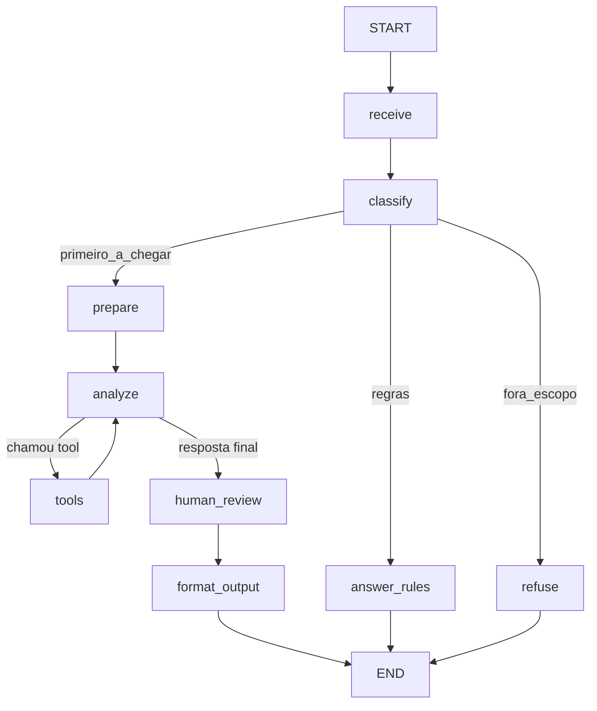

# Semana 1, exercício 2 (completo): o despachante do porto

**Quando:** fim da semana (quarta a sexta). **Tema:** LangChain e LangGraph, parte 2: condicionais, tool calling e human-in-the-loop. **Dados:** [`dados/frota_tempestade.json`](dados/frota_tempestade.json). **Pré-requisito:** exercício 1 concluído.

## O desafio, em poucas palavras

No exercício 1 o agente respondia "quem chega primeiro" lendo uma lista de navios. Agora o mundo ficou mais realista, como no desafio final: há **tempestade**, **combustível** e **perguntas variadas** de um operador.

Seu agente passa a ser um **despachante** que:

1. entende **o que o operador está perguntando** (e desvia o fluxo conforme a pergunta);
2. usa **ferramentas** (código) para calcular, em vez de "adivinhar" contas;
3. **pede a aprovação de um humano** antes de entregar a recomendação final.

## O que você vai aprender

- **Arestas condicionais** e funções de roteamento.
- **Saída estruturada** para classificar a pergunta.
- **Tool calling**: o modelo escolhe qual ferramenta chamar e o código a executa.
- O ciclo `LLM ⇄ ferramentas` no LangGraph (`ToolNode`).
- **Human-in-the-loop** com checkpointer e `interrupt`.

## As regras do problema

| Regra | Descrição |
|---|---|
| ETA | `ETA (horas) = distância (nm) / velocidade efetiva (nós)` |
| Tempestade | navio em tempestade não pode passar de **12 nós** (velocidade efetiva = `min(velocidade, 12)`) |
| Reserva de combustível | navio com combustível **abaixo da reserva** está em condição insegura e **não concorre** (não pode zarpar) |

Os dados:

| Navio | Distância (nm) | Velocidade (nós) | Tempestade | Combustível (t) | Reserva (t) |
|---|---:|---:|:---:|---:|---:|
| S1-FAROL | 700 | 14 | não | 30 | 33 |
| S2-MARE | 760 | 16 | **sim** | 100 | 42 |
| S3-CORAL | 680 | 12 | não | 115 | 51 |
| S4-ATLAS | 820 | 14 | **sim** | 145 | 60 |

## O grafo que você vai construir



| Nó | Tipo | O que faz |
|---|---|---|
| `receive` | código | carrega `dados/frota_tempestade.json` |
| `classify` | LLM (saída estruturada) | classifica a pergunta: `primeiro_a_chegar`, `regras` ou `fora_escopo` |
| `prepare` | código | monta as mensagens iniciais da análise (prompt + frota) |
| `analyze` | LLM com tools | chama as ferramentas e, no fim, escreve a recomendação |
| `tools` | `ToolNode` | executa as ferramentas pedidas pelo modelo |
| `human_review` | `interrupt` | pausa e espera o operador aprovar ou rejeitar |
| `format_output` | código | monta o texto final |
| `answer_rules` | LLM | responde dúvidas sobre as regras, sem ferramentas |
| `refuse` | código | recusa perguntas fora do escopo |

As ferramentas ficam em `src/graph/tools.py` (acréscimo à estrutura, na raiz de `graph`):

| Ferramenta | Entrada | Saída |
|---|---|---|
| `calcular_eta_horas` | `distancia_nm`, `velocidade_kn` | ETA em horas |
| `velocidade_efetiva` | `velocidade_kn`, `em_tempestade` | velocidade após o limite de tempestade |
| `reserva_ok` | `combustivel_t`, `reserva_t` | `True` se o combustível cobre a reserva |

## Passo a passo

Faça em três partes. Cada parte termina com o grafo funcionando.

### Parte A: condicional

1. Evolua o `state.py` com `intent`, `messages`, `recomendacao`, `aprovado`, `nota_operador` (os campos novos estão no gabarito).
2. Crie `prompts/classify_prompt.py` e o nó `classify` com **saída estruturada** (`Intencao` com um campo `intent` limitado a três valores).
3. Crie `routing.py` com `route_by_intent`.
4. Crie os nós `answer_rules` (LLM com o texto das regras no prompt) e `refuse` (texto fixo).
5. No `builder.py`, use `add_conditional_edges("classify", route_by_intent, {...})`. Por enquanto, ligue `primeiro_a_chegar` ao `decide` e ao `format_output` do exercício 1 (reutilize, mantendo `resposta_llm` no estado). Na Parte B e na Parte C esse trecho será substituído.

Teste as três perguntas: "Qual navio chega primeiro?", "Qual a velocidade segura em tempestade?" e "Qual a capital do Brasil?".

### Parte B: tool calling

1. Crie `src/graph/tools.py` com as três ferramentas (`@tool`) e a lista `TOOLS`.
2. Crie o prompt `analyze_prompt.py` instruindo: para cada navio, verificar a reserva, calcular a velocidade efetiva e o ETA **usando as ferramentas**; nunca calcular de cabeça.
3. Crie os nós `prepare` e `analyze` (o modelo vem de `get_llm().bind_tools(TOOLS)`).
4. No `builder.py`, adicione `ToolNode(TOOLS)` e a aresta condicional `tools_condition` que decide: se o modelo pediu uma ferramenta, vai a `tools`; se não, segue adiante. Feche o ciclo `tools → analyze`.

Teste: "Qual navio chega primeiro?". Confira os resultados contra a tabela abaixo.

### Parte C: human-in-the-loop

1. Compile o grafo com um **checkpointer** (`MemorySaver`). Ele guarda o estado para o grafo poder pausar e retomar.
2. Crie o nó `human_review`, que chama `interrupt(...)` com a recomendação e espera uma resposta do operador (`{"aprovado": bool, "nota": str}`).
3. Crie `format_output` para tratar aprovado e rejeitado.
4. No `main.py`, depois do `invoke`, verifique se o grafo pausou. Se sim, mostre a recomendação, leia `s` ou `n` e retome com `Command(resume=...)`.

> No desafio final, **humanos não emitem comandos** aos navios: só agentes autenticados comandam. Aqui o humano aprova uma **recomendação** (um texto), não um comando. Combine com a turma essa diferença.

## Resultado esperado

Para "Qual navio chega primeiro ao porto?":

| Navio | Situação | Velocidade efetiva | ETA (horas) |
|---|---|---:|---:|
| S1-FAROL | **bloqueado**: 30 t < reserva de 33 t | - | - |
| **S3-CORAL** | ok | 12 | **56,67** |
| S2-MARE | tempestade: 16 → 12 | 12 | 63,33 |
| S4-ATLAS | tempestade: 14 → 12 | 12 | 68,33 |

Resposta correta: **S3-CORAL**, com ETA de 56,67 horas.

Execução esperada:

```text
Pergunta: Qual navio chega primeiro ao porto?
Recomendação do agente:
  S3-CORAL chega primeiro (56,67 h). S1-FAROL está bloqueado por combustível abaixo da reserva.
Aprovar? (s/n): s
Nota (opcional): conferido com o plano de rota
APROVADO pelo operador.
...
```

Outros casos:

| Pergunta | Caminho | Saída esperada |
|---|---|---|
| Qual a velocidade segura em tempestade? | `answer_rules` | menciona o limite de 12 nós |
| Qual a capital do Brasil? | `refuse` | "Pergunta fora do escopo..." |
| Qual navio chega primeiro? (operador digita `n`) | `human_review` | "REJEITADO pelo operador" com a nota |

## Como verificar

- [ ] A pergunta de chegada passa por `classify`, `prepare`, `analyze`, `tools` e `human_review`.
- [ ] O modelo chamou as ferramentas (veja as mensagens `tool` no estado ou no trace).
- [ ] O S1-FAROL foi excluído por combustível e o S3-CORAL venceu.
- [ ] As três intenções seguem caminhos diferentes.
- [ ] O grafo realmente **pausa** em `human_review` e retoma com a resposta do operador.
- [ ] O prompt da análise proíbe o cálculo "de cabeça".

## Para pensar

1. Por que `route_by_intent` é código e não outra chamada ao LLM?
2. O que aconteceria se o modelo ignorasse `reserva_ok`? Como você protegeria isso em código (por exemplo, uma validação depois da análise)?
3. Em que parte do desafio final o humano-no-circuito **não** pode aprovar comandos? Que ações humanas são permitidas?
4. Quantas chamadas ao LLM esse fluxo faz para uma pergunta de chegada? Em um sistema com orçamento de tokens, onde você economizaria?

## Desafio extra (opcional)

- Adicione um nó de **validação determinística** depois do `analyze`: recalcule os ETAs em Python e compare com a recomendação; se divergir, volte ao `analyze` no máximo 2 vezes.
- Adicione um limite de passos no ciclo `analyze ⇄ tools` para evitar laço infinito.
- Mostre o diagrama do grafo com `print(graph.get_graph().draw_mermaid())`.

---

# Como resolver (gabarito do instrutor)

## Ideia geral

Três conceitos se somam ao exercício 1:

1. **Roteamento condicional.** Uma função lê o estado e devolve o nome do próximo caminho.
2. **Tool calling.** O modelo não executa nada: ele **pede** uma ferramenta (nome e argumentos). O `ToolNode` executa o código e devolve o resultado como mensagem. Depois o modelo continua.
3. **Pausa para humano.** O `interrupt` salva o estado no checkpointer e para o grafo. A retomada com `Command(resume=...)` continua do ponto em que parou.

## `src/graph/state.py`

```python
from typing import Annotated, TypedDict

from langgraph.graph.message import add_messages


class State(TypedDict, total=False):
    pergunta: str
    frota: dict
    intent: str
    messages: Annotated[list, add_messages]
    recomendacao: str
    aprovado: bool
    nota_operador: str
    resposta_llm: str  # só usado na Parte A, herdado do exercício 1
    resultado: str
```

`Annotated[list, add_messages]` diz ao LangGraph para **acrescentar** mensagens à lista em vez de substituí-la. É o que permite o ciclo com ferramentas.

## `src/graph/tools.py`

```python
from langchain_core.tools import tool

LIMITE_TEMPESTADE_KN = 12.0


@tool
def calcular_eta_horas(distancia_nm: float, velocidade_kn: float) -> float:
    """Calcula o ETA em horas: distancia_nm dividida por velocidade_kn."""
    return round(distancia_nm / velocidade_kn, 2)


@tool
def velocidade_efetiva(velocidade_kn: float, em_tempestade: bool) -> float:
    """Velocidade efetiva do navio. Em tempestade o limite é de 12 nós."""
    return min(velocidade_kn, LIMITE_TEMPESTADE_KN) if em_tempestade else velocidade_kn


@tool
def reserva_ok(combustivel_t: float, reserva_t: float) -> bool:
    """True se o combustível a bordo cobre a reserva mínima (navio pode zarpar)."""
    return combustivel_t >= reserva_t


TOOLS = [calcular_eta_horas, velocidade_efetiva, reserva_ok]
```

A **docstring** de cada ferramenta é o que o modelo lê para decidir quando usá-la. Os tipos viram o schema dos argumentos.

## Prompts

`src/graph/prompts/classify_prompt.py`:

```python
from langchain_core.prompts import ChatPromptTemplate

CLASSIFY_PROMPT = ChatPromptTemplate.from_messages(
    [
        (
            "system",
            "Classifique a pergunta de um operador de porto em uma intenção:\n"
            "- primeiro_a_chegar: qual navio chega primeiro ao porto\n"
            "- regras: dúvida sobre as regras de navegação (velocidade, tempestade, combustível)\n"
            "- fora_escopo: qualquer outro assunto",
        ),
        ("human", "{pergunta}"),
    ]
)
```

`src/graph/prompts/analyze_prompt.py`:

```python
from langchain_core.prompts import ChatPromptTemplate

ANALYZE_PROMPT = ChatPromptTemplate.from_messages(
    [
        (
            "system",
            "Você é um despachante de porto. Para CADA navio faça, nesta ordem:\n"
            "1) use reserva_ok; se for False, o navio está bloqueado e não concorre;\n"
            "2) use velocidade_efetiva com o campo em_tempestade;\n"
            "3) use calcular_eta_horas com a velocidade efetiva.\n"
            "Nunca calcule de cabeça: use sempre as ferramentas. "
            "No fim, diga qual navio chega primeiro e liste o ETA de cada navio elegível "
            "e os navios bloqueados com o motivo.",
        ),
        ("human", "Frota:\n{frota}\n\nPergunta: {pergunta}"),
    ]
)
```

`src/graph/prompts/rules_prompt.py`:

```python
from langchain_core.prompts import ChatPromptTemplate

REGRAS = (
    "- Velocidade-alvo: de 0 a 18 nós, em passos de 0,5.\n"
    "- Em tempestade, o limite de velocidade é de 12 nós.\n"
    "- Navio com combustível abaixo da reserva mínima (15% do tanque) não pode zarpar.\n"
    "- ETA em horas = distância em nm dividida pela velocidade em nós."
)

RULES_PROMPT = ChatPromptTemplate.from_messages(
    [
        ("system", "Responda de forma curta usando apenas estas regras:\n" + REGRAS),
        ("human", "{pergunta}"),
    ]
)
```

## Nós

`src/graph/nodes/receive.py` (troque o arquivo de dados):

```python
import json
from pathlib import Path

from src.graph.state import State

ARQUIVO = Path(__file__).resolve().parents[3] / "dados" / "frota_tempestade.json"


def receive(state: State) -> dict:
    return {"frota": json.loads(ARQUIVO.read_text(encoding="utf-8"))}
```

`src/graph/nodes/classify.py`:

```python
from typing import Literal

from pydantic import BaseModel

from src.graph.prompts.classify_prompt import CLASSIFY_PROMPT
from src.graph.state import State
from src.utils.llm_adapter import get_llm


class Intencao(BaseModel):
    intent: Literal["primeiro_a_chegar", "regras", "fora_escopo"]


def classify(state: State) -> dict:
    chain = CLASSIFY_PROMPT | get_llm().with_structured_output(Intencao)
    return {"intent": chain.invoke({"pergunta": state["pergunta"]}).intent}
```

O `Literal` obriga o modelo a devolver um dos três valores. Isso torna o roteamento seguro.

`src/graph/nodes/prepare.py`:

```python
import json

from src.graph.prompts.analyze_prompt import ANALYZE_PROMPT
from src.graph.state import State


def prepare(state: State) -> dict:
    mensagens = ANALYZE_PROMPT.format_messages(
        frota=json.dumps(state["frota"], ensure_ascii=False),
        pergunta=state["pergunta"],
    )
    return {"messages": mensagens}
```

`src/graph/nodes/analyze.py`:

```python
from src.graph.state import State
from src.graph.tools import TOOLS
from src.utils.llm_adapter import get_llm


def analyze(state: State) -> dict:
    llm = get_llm().bind_tools(TOOLS)
    return {"messages": [llm.invoke(state["messages"])]}
```

`bind_tools` informa ao modelo quais ferramentas existem. A resposta pode ser um pedido de ferramenta (`tool_calls`) ou o texto final.

`src/graph/nodes/human_review.py`:

```python
from langgraph.types import interrupt

from src.graph.state import State


def human_review(state: State) -> dict:
    recomendacao = str(state["messages"][-1].content)
    decisao = interrupt(
        {"recomendacao": recomendacao, "pergunta": "Aprovar a recomendação?"}
    )
    return {
        "recomendacao": recomendacao,
        "aprovado": bool(decisao["aprovado"]),
        "nota_operador": decisao.get("nota", ""),
    }
```

Ao retomar, o LangGraph **executa o nó de novo desde o início**, e o `interrupt` devolve o valor enviado em `Command(resume=...)`. Por isso, não coloque efeitos colaterais antes do `interrupt`.

`src/graph/nodes/format_output.py`:

```python
from src.graph.state import State


def format_output(state: State) -> dict:
    nota = state.get("nota_operador", "")
    if state.get("aprovado"):
        texto = f"APROVADO pelo operador.\n{state['recomendacao']}"
    else:
        texto = "REJEITADO pelo operador."
    if nota:
        texto += f"\nNota do operador: {nota}"
    return {"resultado": texto}
```

`src/graph/nodes/answer_rules.py`:

```python
from src.graph.prompts.rules_prompt import RULES_PROMPT
from src.graph.state import State
from src.utils.llm_adapter import get_llm


def answer_rules(state: State) -> dict:
    resposta = (RULES_PROMPT | get_llm()).invoke({"pergunta": state["pergunta"]})
    return {"resultado": str(resposta.content)}
```

`src/graph/nodes/refuse.py`:

```python
from src.graph.state import State


def refuse(state: State) -> dict:
    return {"resultado": "Pergunta fora do escopo (navios, portos e regras de operação)."}
```

## `src/graph/routing.py`

```python
from src.graph.state import State


def route_by_intent(state: State) -> str:
    return state["intent"]
```

A função devolve uma chave; o dicionário do `builder` traduz a chave para o nome do nó.

## `src/graph/builder.py`

```python
from langgraph.checkpoint.memory import MemorySaver
from langgraph.graph import END, START, StateGraph
from langgraph.prebuilt import ToolNode, tools_condition

from src.graph.nodes.analyze import analyze
from src.graph.nodes.answer_rules import answer_rules
from src.graph.nodes.classify import classify
from src.graph.nodes.format_output import format_output
from src.graph.nodes.human_review import human_review
from src.graph.nodes.prepare import prepare
from src.graph.nodes.receive import receive
from src.graph.nodes.refuse import refuse
from src.graph.routing import route_by_intent
from src.graph.state import State
from src.graph.tools import TOOLS


def build_graph():
    graph = StateGraph(State)
    graph.add_node("receive", receive)
    graph.add_node("classify", classify)
    graph.add_node("prepare", prepare)
    graph.add_node("analyze", analyze)
    graph.add_node("tools", ToolNode(TOOLS))
    graph.add_node("human_review", human_review)
    graph.add_node("format_output", format_output)
    graph.add_node("answer_rules", answer_rules)
    graph.add_node("refuse", refuse)

    graph.add_edge(START, "receive")
    graph.add_edge("receive", "classify")
    graph.add_conditional_edges(
        "classify",
        route_by_intent,
        {
            "primeiro_a_chegar": "prepare",
            "regras": "answer_rules",
            "fora_escopo": "refuse",
        },
    )
    graph.add_edge("prepare", "analyze")
    graph.add_conditional_edges(
        "analyze", tools_condition, {"tools": "tools", END: "human_review"}
    )
    graph.add_edge("tools", "analyze")
    graph.add_edge("human_review", "format_output")
    graph.add_edge("format_output", END)
    graph.add_edge("answer_rules", END)
    graph.add_edge("refuse", END)
    return graph.compile(checkpointer=MemorySaver())
```

`tools_condition` é uma função pronta: devolve `"tools"` se a última mensagem do modelo pediu ferramentas e `END` caso contrário. O ciclo `analyze → tools → analyze` repete até o modelo dar a resposta final.

## `src/app/main.py`

```python
from langgraph.types import Command

from src.graph.builder import build_graph
from src.utils.langfuse_client import flush, run_config


def main() -> None:
    graph = build_graph()
    config = run_config(configurable={"thread_id": "semana-1"})
    pergunta = input("Pergunta: ").strip() or "Qual navio chega primeiro ao porto?"

    saida = graph.invoke({"pergunta": pergunta}, config)

    if "__interrupt__" in saida:  # o grafo pausou em human_review
        pedido = saida["__interrupt__"][0].value
        print("Recomendação do agente:\n", pedido["recomendacao"])
        aprovado = input("Aprovar? (s/n): ").strip().lower() == "s"
        nota = input("Nota (opcional): ").strip()
        saida = graph.invoke(Command(resume={"aprovado": aprovado, "nota": nota}), config)

    print(saida["resultado"])
    flush()


if __name__ == "__main__":
    main()
```

Com o `invoke`, uma pausa aparece na chave `__interrupt__` do resultado, com o valor enviado ao `interrupt()`.

O `thread_id` identifica a conversa no checkpointer. Para uma nova pergunta no mesmo processo, use outro `thread_id`.

## O que comentar com a turma

- **Dois tipos de decisão.** `classify` usa o LLM para entender a pergunta; `route_by_intent` é código puro e previsível.
- **LLM escolhe, código executa.** O modelo pediu `calcular_eta_horas(700, 14)`; quem fez a conta foi Python. Isso elimina o erro aritmético do exercício 1.
- **O que pode dar errado.** O modelo pode esquecer uma ferramenta ou pular um navio. A defesa é validar em código (desafio extra) e ter prompts claros.
- **HITL e o desafio.** Aqui o humano aprova um texto. No desafio final, a regra é outra: comandos só de agentes. O humano pode reiniciar um agente, pedir pausa, pedir diagnóstico ou anotar.
- **Custo.** Uma pergunta de chegada gera várias chamadas (classificação, rodadas de ferramentas, resposta). Em um orçamento de tokens, o roteamento por intenção evita gastar o fluxo caro em perguntas simples.
- **Ponte para a semana 2.** O `analyze` pode virar dois agentes (um que propõe, outro que revisa).
